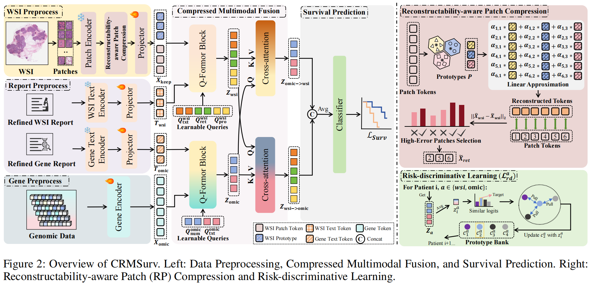

# CRMSurv
- [x] 2026-06-22 ⭐: Code release !
<summary>
  <b>CRMSurv: Learning Compact and Risk-discriminated Multimodal Representations for Cancer Survival Analysis</b>.
  
  <br><em>Huayi Wang, Haochao Ying, Yutao Sun, Jian Wu </em></br>
</summary>



</details>
**Summary:** Here is the official implementation of the paper "CRMSurv: Learning Compact and Risk-discriminated Multimodal Representations for Cancer Survival Analysis".

### Pre-requisites:
```bash
torch 2.3.1+cu121
scikit-survival 0.23.0
Python >=3.6
kmeans-pytorch
numpy 1.26.4
pandas 2.2.2
scikit-learn 1.5.1
```

### Prepare your data
#### WSIs
1. Download diagnostic WSIs from [TCGA](https://portal.gdc.cancer.gov/)
2. Use the WSI processing tool provided by [CLAM](https://github.com/mahmoodlab/CLAM) to extract 512-dim feature by CONCH for each 256 $\times$ 256 patch (20x), which we then save as `.pt` files for each WSI. So, we get one `pt_files` folder storing `.pt` files for all WSIs of one study.

The final structure of datasets should be as following:
```bash
DATA_ROOT_DIR/
    └──pt_files/
        ├── slide_1.pt
        ├── slide_2.pt
        └── ...
```

DATA_ROOT_DIR is the base directory of cancer type (e.g. the directory to TCGA_BLCA), which should be passed to the model with the argument `--data_root_dir` as shown in [run.sh](run.sh).

#### Genomics
In this work, we directly use the preprocessed genomic data and signatures.csv provided by [PORPOISE](https://github.com/mahmoodlab/PORPOISE), stored in folder [csv](./csv) and [splits](./splits).

#### WSI Report
Directly use the TCGA text reports compiled in the article below, and employ the [CONCH text encoder](https://github.com/mahmoodlab/CONCH) to obtain WSI text embeddings.
```bash
@article{kefeli2024tcga,
  title={TCGA-Reports: A machine-readable pathology report resource for benchmarking text-based AI models},
  author={Kefeli, Jenna and Tatonetti, Nicholas},
  journal={Patterns},
  volume={5},
  number={3},
  year={2024},
  publisher={Elsevier}
}

```

#### Genomic Report
Please refer to the article below for the method of generating the genomic report. Details regarding the construction process can be found in the appendix of our article.
```bash
@article{huang2025survagent,
  title={SurvAgent: Hierarchical CoT-Enhanced Case Banking and Dichotomy-Based Multi-Agent System for Multimodal Survival Prediction},
  author={Huang, Guolin and Chen, Wenting and Yang, Jiaqi and Lyu, Xinheng and Luo, Xiaoling and Yang, Sen and Xing, Xiaohan and Shen, Linlin},
  journal={arXiv preprint arXiv:2511.16635},
  year={2025}
}
```
Later, [PubMedBERT](https://huggingface.co/NeuML/pubmedbert-base-embeddings) is used to encode the genomic text.

## Training-Validation Splits
Splits for each cancer type are found in the `splits/5foldcv ` folder, which are randomly partitioned each dataset using 5-fold cross-validation. Each one contains splits_{k}.csv for k = 1 to 5. 

## Running Experiments
Given that the RP module requires WSI prototypes as base representations, we employ [K-means algorithm](https://github.com/subhadarship/kmeans_pytorch) to extract these prototypes prior to training CRMSurv. Run the following command:
```bash
pip install kmeans-pytorch
```

bash `save_kmeans.sh`: 
```bash
CUDA_VISIBLE_DEVICES=0 python save_kmeans.py --which_splits 5foldcv \
                                      --dataset tcga_blca \
                                      --data_root_dir your_root \
                                      --modal path \
                                      --model crmsurv \
                                      --cancer_type blca \
                                      --cluster 8 \
                                      --save_cluster_path ./Data/WSI_kmeans_8,
```

To train CRMSurv, you can specify the argument in the bash `main.sh` and run the command:
```bash
CUDA_VISIBLE_DEVICES=0 python main.py --which_splits 5foldcv \
                                      --dataset tcga_blca \
                                      --data_root_dir your_root \
                                      --modal triattn \
                                      --model crmsurv \
                                      --num_epoch 30 \
                                      --batch_size 1 \
                                      --lr 0.0005 \
                                      --optimizer AdamW \
                                      --scheduler None \
                                      --alpha 1.0 \
                                      --beta 0.1 \
                                      --loss nll_surv_rl \
                                      --cancer_type blca \
                                      --cluster 8 \
                                      --use_compression \
                                      --use_txt \
                                      --use_rl_loss
```


## Acknowledgements
Huge thanks to the authors of following open-source projects:
- [CLAM](https://github.com/mahmoodlab/CLAM)
- [CONCH](https://github.com/mahmoodlab/CONCH)
- [kmeans-pytorch](https://github.com/subhadarship/kmeans_pytorch)
- [PubMedBERT](https://huggingface.co/NeuML/pubmedbert-base-embeddings)

## License & Citation 
If you find our work useful in your research, please consider citing our paper at:
```bash
@misc{wang2026crmsurv,
      title={CRMSurv: Learning Compact and Risk-discriminated Multimodal Representations for Cancer Survival Analysis}, 
      author={Huayi Wang, Haochao Ying, Yutao Sun, Jian Wu},
      year={2026},
}

